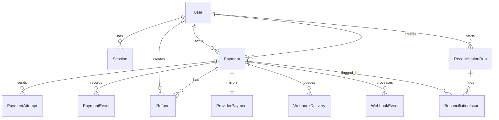

# Domain Model

## User
- Schema/model file: `prisma/schema.prisma` model `User`
- Primary service owner: `src/services/authService.ts` via `login()` and `logout()`
- Notes: Users are also the ownership boundary for payments in `src/services/paymentAccessPolicy.ts`.

## Session
- Schema/model file: `prisma/schema.prisma` model `Session`
- Primary service owner: `src/services/authService.ts` via `login()`
- Notes: `src/lib/auth/session.ts` resolves cookie tokens back to session rows before any route is trusted.

## IdempotencyRecord
- Schema/model file: `prisma/schema.prisma` model `IdempotencyRecord`
- Primary service owner: `src/services/paymentService.ts` via `createPaymentWithIdempotency()`
- Notes: This is the durable replay contract. The payment row is not the idempotency mechanism.

## Payment
- Schema/model file: `prisma/schema.prisma` model `Payment`
- Primary service owner: `src/services/paymentService.ts` via `createPaymentWithIdempotency()`
- Notes: Local status is intentionally allowed to drift behind provider truth until `src/services/webhookService.ts` or `src/services/reconciliationService.ts` corrects it.

## PaymentAttempt
- Schema/model file: `prisma/schema.prisma` model `PaymentAttempt`
- Primary service owner: `src/services/providerSimulatorService.ts` via `dispatchPaymentToProvider()`
- Notes: Attempts preserve retry/debug history instead of collapsing all provider communication into the payment row.

## ProviderPayment
- Schema/model file: `prisma/schema.prisma` model `ProviderPayment`
- Primary service owner: `src/services/providerSimulatorService.ts` via `dispatchPaymentToProvider()`
- Notes: This is the simulated external source of truth that reconciliation compares against.

## WebhookDelivery
- Schema/model file: `prisma/schema.prisma` model `WebhookDelivery`
- Primary service owner: `src/services/providerSimulatorService.ts` via `dispatchPaymentToProvider()` and `deliverPendingWebhooks()`
- Notes: Outbound delivery tracking exists so "provider succeeded but our local system never heard about it" is a first-class state.

## WebhookEvent
- Schema/model file: `prisma/schema.prisma` model `WebhookEvent`
- Primary service owner: `src/services/webhookService.ts` via `processProviderWebhook()`
- Notes: Inbound processing is idempotent on `providerEventId`, not just on payment id: a `PROCESSED` event short-circuits (`src/services/webhookService.ts:30-37`) and the column is unique (`prisma/schema.prisma:216`). The check runs before the transaction, so concurrent duplicates are caught by the unique constraint rather than handled gracefully.

## PaymentEvent
- Schema/model file: `prisma/schema.prisma` model `PaymentEvent`
- Primary service owner: multiple services append here, but `src/repositories/paymentEventRepository.ts` is the single write boundary
- Notes: This is the transaction history requested in the brief. Operators read this trail in `src/components/payments/PaymentDetailsCard.tsx`.

## Refund
- Schema/model file: `prisma/schema.prisma` model `Refund`
- Primary service owner: `src/services/refundService.ts` via `createRefundForPayment()`
- Notes: Full refunds transition the payment to `REFUNDED`; partial refunds leave the payment in `SUCCEEDED`. The refund path never updates `ProviderPayment.status`, so after a full refund the provider mirror still says `SUCCEEDED` and `runReconciliation()` records a `STATUS_MISMATCH` for that payment (`src/services/reconciliationService.ts:58-81`). Refunds are marked `SUCCEEDED` in the same transaction that creates them (`src/services/refundService.ts:62`); no real provider is called.

## ReconciliationRun
- Schema/model file: `prisma/schema.prisma` model `ReconciliationRun`
- Primary service owner: `src/services/reconciliationService.ts` via `runReconciliation()`
- Notes: Reconciliation runs are historical records, not a single mutable report.

## ReconciliationIssue
- Schema/model file: `prisma/schema.prisma` model `ReconciliationIssue`
- Primary service owner: `src/services/reconciliationService.ts` via `runReconciliation()`
- Notes: Missing provider rows, missing local rows, missing webhook deliveries, and status mismatches are stored explicitly so operators can reason about eventual consistency failures.
